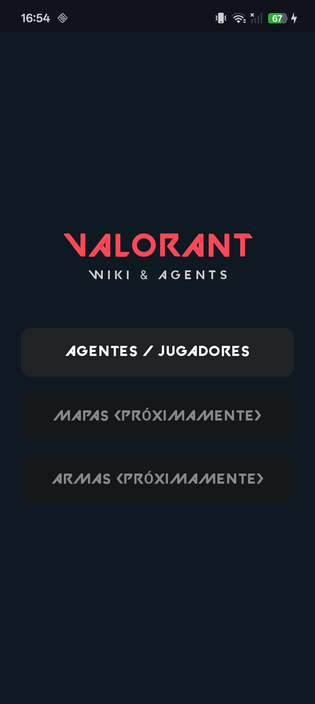

# ¡Hola! Soy Samir Macías 👋

Soy un **Desarrollador de Software Full-Stack (Autónomo)** radicado en **Madrid, España** 🇪🇸. Tengo una gran pasión por el desarrollo backend, el diseño de bases de datos relacionales y la creación de APIs escalables. Actualmente curso el ciclo de **Desarrollo de Aplicaciones Multiplataforma (DAM)** y me encuentro en constante evolución técnica hacia la Ingeniería del Software.

Me enfoco en escribir código limpio, optimizar el rendimiento y diseñar sistemas eficientes. Cuando no estoy programando servicios web o ajustando consultas SQL, me gusta desarrollar aplicaciones móviles nativas y experimentar con la programación de mecánicas 3D para videojuegos.

---

### 🚀 Sobre Mí

*   💻 Especializado en desarrollo **Backend** (Java, Node.js, C#) y arquitecturas de microservicios.
*   📱 Experiencia en desarrollo móvil multiplataforma (**Angular / Ionic**) y nativo para **Android** utilizando **Kotlin**.
*   🎮 Desarrollador entusiasta de videojuegos implementando mecánicas y físicas en **Unity 6**.
*   🌱 Actualmente explorando integraciones para sistemas de facturación electrónica (Veri*Factu / Ley Crea y Crece).
*   ⚡ **Dato curioso:** ¡Me apasiona el mundo del motor y disfruto analizando a fondo las especificaciones técnicas de las motos! 🏍️

---

### 🛠️ Tecnologías y Herramientas

**Backend & Bases de Datos**

  
  
  
  
  
  
  
  

**Frontend & Móvil (Android nativo & Híbrido)**

  
  
  
  
  
  

**Game Dev, Herramientas & SO**

  
  
  
  
  

---

### 💼 Proyectos Destacados

#### 🎮 Valorant Wiki & Agents (Android / Kotlin)
Aplicación nativa para Android desarrollada en Kotlin que permite consultar información detallada sobre los agentes, sus habilidades y mapas del juego. Cuenta con diseño responsivo adaptado para tablets y una próxima integración para la consulta de estadísticas de jugador.

| Inicio | Agentes | Detalle de Habilidades | Vista en Tablet |
|:---:|:---:|:---:|:---:|
|  |  |  |  |

#### 📇 Tarjeta de Presentación Digital (Android / Kotlin)
Aplicación móvil que funciona como un portafolio profesional interactivo. Incluye soporte dinámico para modo claro y oscuro, facilitando el acceso a mi repositorio de GitHub, perfil de LinkedIn y la descarga directa de mi CV en PDF mediante códigos QR y botones de acción.

| Modo Claro | Modo Oscuro |
|:---:|:---:|
|  |  |

#### ⚙️ Otros Desarrollos
*   📈 **DevMetrics API:** API RESTful en Spring Boot y Java 21 para el cálculo de métricas de productividad de desarrolladores.
*   📚 **App Visual:** Plataforma educativa soportada por un backend en Node.js, Express y MySQL.
*   🧾 **Facturación Automatizada B2B:** Sistema backend con integración a WhatsApp para la gestión de facturas electrónicas adaptadas a la normativa española.
*   👾 **Tower Defense en 3D:** Videojuego desarrollado en Unity utilizando scripts en C# para mecánicas de disparo, *raycasting* y máquinas de estado.

---

### 📊 Estadísticas

  
  

  

---

### 📫 Contacto

  
  

